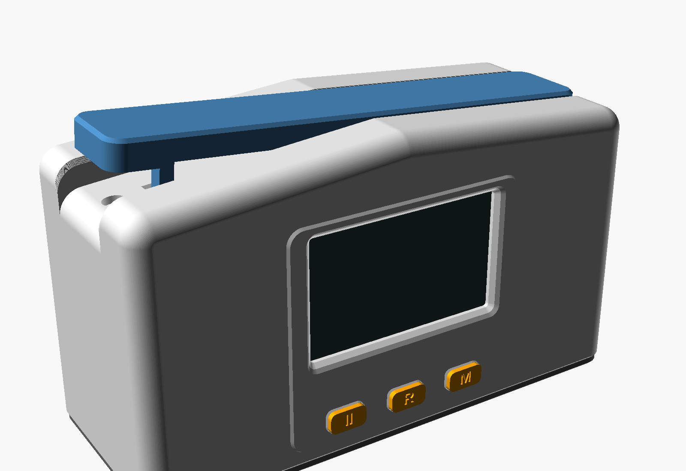
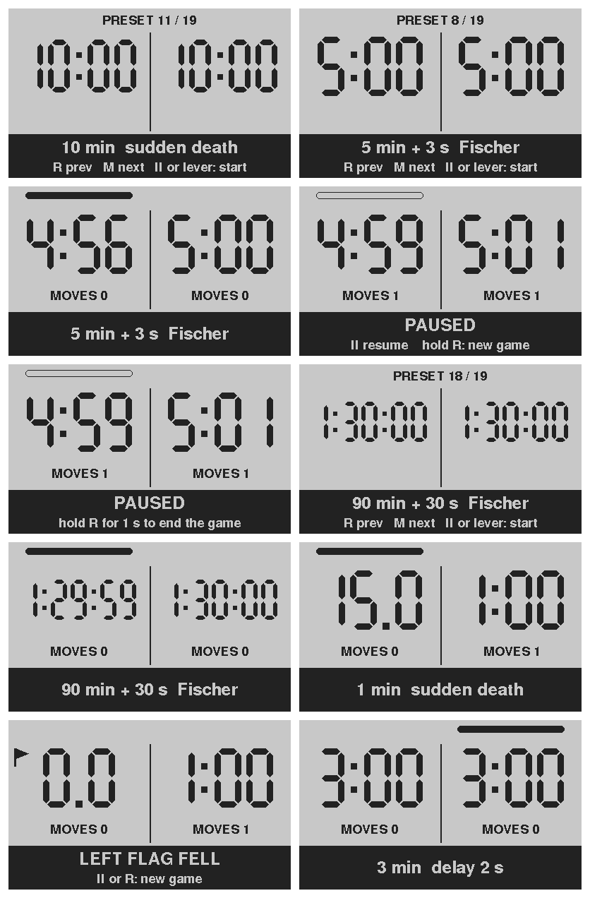

# OpenChessClock

[](https://github.com/codingsushi79/openchessclock/actions/workflows/repo-check.yml)
[](https://github.com/codingsushi79/openchessclock/actions/workflows/firmware.yml)
[](https://github.com/codingsushi79/openchessclock/actions/workflows/cad.yml)
[](LICENSE)

An open-source, build-it-yourself tournament chess clock: a rocker lever in a framed channel, a
2.7" reflective Sharp memory LCD with big 7-segment digits, and three buttons under the display.
It runs on a Raspberry Pi Pico, and every part except the electronics is 3D printed.



## Start here

| I want to… | Go to |
|---|---|
| See what I need to buy and print | [PARTS.md](PARTS.md) |
| Wire it up | [WIRING.md](WIRING.md) |
| Build it step by step | [ASSEMBLY.md](ASSEMBLY.md) |
| Flash the firmware | [Flashing the firmware](#flashing-the-firmware) below |
| Try the firmware without any hardware | [Testing without hardware](#testing-without-hardware) below |
| Change the 3D model | [`cad/chess_clock.scad`](cad/chess_clock.scad) and [Changing the design](#changing-the-design) |
| Report a problem or suggest something | [Open an issue](https://github.com/codingsushi79/openchessclock/issues/new/choose) |
| Help improve the project | [CONTRIBUTING.md](CONTRIBUTING.md) |

**Build order in short:** order the [parts](PARTS.md) → print the [STLs](stl/) → follow
[ASSEMBLY.md](ASSEMBLY.md) (it points you to [WIRING.md](WIRING.md) at the right moment) → flash
[the firmware](firmware/chess_clock_pico/chess_clock_pico.ino) → play.

## What's in this repository

| Path | What it is |
|---|---|
| [`PARTS.md`](PARTS.md) | Parts list with links, screws, magnets, print settings |
| [`WIRING.md`](WIRING.md) | Pin-by-pin wiring for the Pico |
| [`ASSEMBLY.md`](ASSEMBLY.md) | Step-by-step build, magnet polarity, switch adjustment, first power-up |
| [`cad/chess_clock.scad`](cad/chess_clock.scad) | Parametric OpenSCAD source for every printed part |
| [`stl/`](stl/) | Ready-to-print STLs, already oriented on the bed |
| [`firmware/chess_clock_pico/`](firmware/chess_clock_pico/) | Arduino sketch for the Pico |
| [`images/`](images/) | Renders and the firmware's screen layouts |
| [`test/`](test/) | Desktop simulator: runs the real firmware on your computer, checks the timing, saves every screen as an image |
| [`legacy/`](legacy/) | Earlier versions: the Arduino Nano + TM1637 sketch and the first box enclosure |
| [`scripts/check_repo.py`](scripts/check_repo.py) | Checks that every required file is present and every local link works (run by CI) |
| [`CONTRIBUTING.md`](CONTRIBUTING.md) | How to report issues, make changes, and open a pull request |
| [`CODE_OF_CONDUCT.md`](CODE_OF_CONDUCT.md) | How we treat each other here |
| [`CHANGELOG.md`](CHANGELOG.md) | What changed in each version |
| [`LICENSE`](LICENSE) | MIT license (covers firmware, CAD, STLs, images and docs) |

## Features
- **Timing modes:** Fischer increment, simple (US) delay, Bronstein delay, sudden death. 19 presets
  from 1+0 bullet to 90+30 classical.
- **Display:** shows tenths of a second under 20 s, H:MM:SS for long games, a move counter for each
  side, a flag icon when time runs out, and the paused side blinking.
- **Low-time warning:** one beep at 10 s, then a tick every second for the last 5.
- **Exact timing:** each lever press is timestamped at the first switch contact, so debouncing never
  costs a player time. The screen is drawn on the Pico's second core, so redrawing never delays a
  press.



## Controls
| Where | Lever | II | R | M |
|---|---|---|---|---|
| Setup | Starts the game: the side whose end is **up** runs | Start | Previous preset | Next preset (hold: sound on/off) |
| Running | Press your end to finish your move | Pause | — | — |
| Paused | — | Resume | Hold 1 s: back to setup | — |
| Flag fell | — | New game | New game | — |

## Flashing the firmware
1. Install the Arduino IDE.
2. Add the RP2040 board package by Earle Philhower (https://github.com/earlephilhower/arduino-pico).
   In **File → Preferences → Additional boards manager URLs**, add
   `https://github.com/earlephilhower/arduino-pico/releases/download/global/package_rp2040_index.json`,
   then install **Raspberry Pi Pico/RP2040** from the Boards Manager.
3. In the Library Manager, install **Adafruit SHARP Memory Display** (it pulls in Adafruit GFX and
   Adafruit BusIO).
4. Open [`firmware/chess_clock_pico/chess_clock_pico.ino`](firmware/chess_clock_pico/chess_clock_pico.ino),
   choose **Raspberry Pi Pico** as the board, hold BOOTSEL while plugging the Pico in, and upload.

Settings at the top of the sketch: `DISPLAY_ROTATION`, `SWAP_LEVER_SIDES`, the low-time warning
thresholds, and the preset list.

## Testing without hardware
[`test/run_tests.sh`](test/run_tests.sh) compiles the real sketch against the real Adafruit GFX
library with stand-ins for the Pico and the display. It plays scripted games: increment, delay,
Bronstein, pause, a flag fall and contact bounce. It prints the clock values and saves every screen
to `test/shots/contact_sheet.png`. It needs `g++`, `git`, and Python with Pillow.

```sh
./test/run_tests.sh
```

## Status
- **CAD:** every part was collision-checked against the others with the lever in both positions and
  at rest.
- **Firmware:** compiled and simulated on a desktop. It has **not** been run on a real Pico yet, so
  expect to tune `DISPLAY_ROTATION` / `SWAP_LEVER_SIDES` on first power-up. If you build one,
  please [tell us how it went](https://github.com/codingsushi79/openchessclock/issues/new?template=build_report.yml)!
- **Measure before printing:** the KW11 switch arm heights vary by seller, so the rib holes are
  slotted for adjustment. The display window's vertical offset is the one unverified dimension
  (see [ASSEMBLY.md step 0](ASSEMBLY.md#0-before-you-print-everything)).

## Changing the design
Everything is driven by the parameters at the top of [`cad/chess_clock.scad`](cad/chess_clock.scad):
box size, lever length and tilt, rail height, fillet radii, part positions, screw sizes. Change a
value, set `part`, render (F6), and export (F7). If you change a part, re-export its STL into
[`stl/`](stl/) in the same pull request; see [CONTRIBUTING.md](CONTRIBUTING.md#changing-the-3d-model).

## Contributing
Bug reports, build reports, fixes and new ideas are all welcome, and you don't need to own a clock to
help: the simulator and the CAD file run on any computer.

- **Found a problem?** [Pick an issue template](https://github.com/codingsushi79/openchessclock/issues/new/choose):
  firmware bug, 3D model / print problem, assembly or docs problem, feature request, or build report.
- **Want to fix something?** Read [CONTRIBUTING.md](CONTRIBUTING.md): fork, branch, run
  `./test/run_tests.sh` and `./scripts/check_repo.py`, then open a pull request.
- Please follow the [Code of Conduct](CODE_OF_CONDUCT.md).

## License
[MIT](LICENSE). Build it, sell it, remix it; just keep the license notice.
